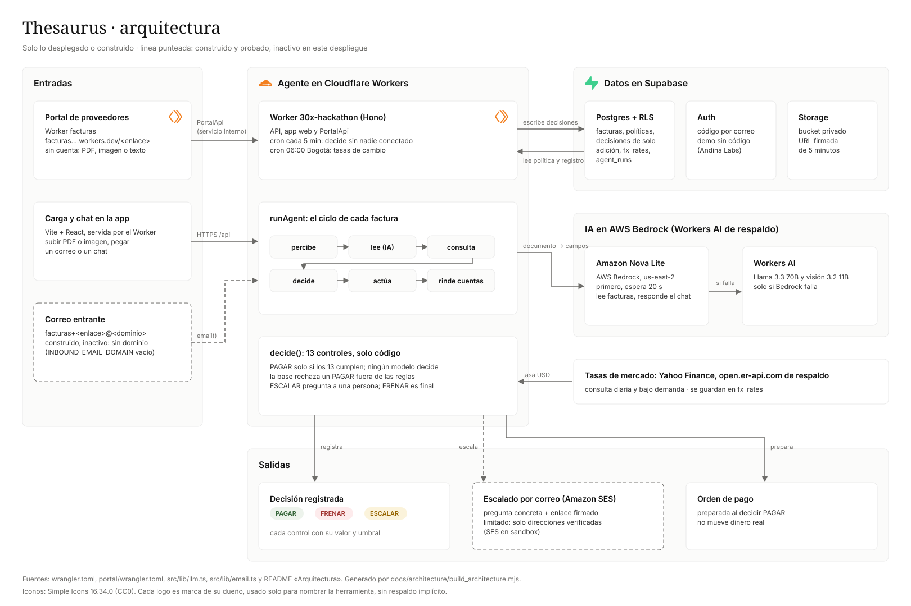

<p align="center">
  
  <br><b>Thesaurus</b> · Paga lo que debes. Frena lo que no. Pregunta cuando dudes.
  <br>El agente de cuentas por pagar que decide con tus reglas. Construido para el reto de Blinka (Hackathon 30X).
</p>

> **TL;DR para evaluadores (30 s)**
>
> | | |
> |---|---|
> | **Reto** | Blinka · «Agentes que pagan por la empresa»: leer facturas, decidir **PAGAR / FRENAR / ESCALAR** dentro de reglas configurables y registrar por qué. |
> | **Demo** | https://30x-hackathon.30x-hackathon-roberto-zuniga.workers.dev/demo → «Probar con mi propia empresa» (sin cuenta ni correo) |
> | **Video** | [Película de 150 s](https://30x-hackathon.30x-hackathon-roberto-zuniga.workers.dev/demo/thesaurus-launch.mp4) · [recorrido sin editar](https://30x-hackathon.30x-hackathon-roberto-zuniga.workers.dev/demo/happy-path.webm) |
> | **Autonomía** | 29/29 facturas con el resultado esperado; 18 decididas de punta a punta sin una persona, 11 escaladas a propósito (ver abajo). |
> | **Seguridad** | 0 pagos fuera de las reglas. Solo la función pura [`decide()`](src/engine/decide.ts) puede producir PAGAR, y un trigger de Postgres ([`supabase/migrations/`](supabase/migrations/)) rechaza cualquier PAGAR que no cumpla los 13 controles. |
> | **Explicabilidad** | Cada factura tiene un registro legible («Lo que hice / Lo que leí / Lo que decidí») en español e inglés, generado con plantillas, nunca por un modelo. |
> | **Código clave** | [`src/engine/`](src/engine/) (reglas) · [`src/agent/loop.ts`](src/agent/loop.ts) (ciclo del agente) · [`docs/demo/DATASET.md`](docs/demo/DATASET.md) (29 facturas normales y trampa) |
> | **Correrlo** | `npm ci && npm test`: sin red ni claves, todo simulado. CI en GitHub Actions. |

## El problema

Una factura llega por correo, PDF o chat. Alguien de finanzas la compara con lo acordado, busca los datos de quien cobra, pide aprobación por chat, crea el pago a mano y concilia en una hoja. Es manual, se repite cada mes y depende de que haya alguien disponible. Lo que falta es confianza: que el agente pague solo lo que debe, explique cada decisión y nunca se pase de sus límites.

## Qué hace Thesaurus

Cada factura recorre el mismo ciclo ([`src/agent/loop.ts`](src/agent/loop.ts)):

**percibe** (PDF, imagen, chat pegado o portal de proveedores) → **lee** (Amazon Nova Lite en AWS Bedrock, con Workers AI de respaldo, en campos con confianza) → **consulta** (directorio, política, periodo, duplicados, tasa de cambio) → **decide** (13 controles deterministas) → **actúa** (registra, escala con una pregunta concreta, prepara la orden de pago) → **rinde cuentas** (el registro).

- **PAGAR**: cumple los 13 controles.
- **FRENAR**: duplicado exacto o sobre el límite por pago. Es final.
- **ESCALAR**: algo se sale de las reglas. Le pregunta a una persona, por ejemplo: *«La factura #2044 de Nube Sur LLC por 4.200 USD supera tu umbral de 2.500 USD. ¿La pago?»*, con Aprobar y Rechazar.

Corre solo cada 5 minutos (cron) y también bajo demanda. No mueve dinero real, tal como pide el reto.

**La IA lee, el código decide, una persona aprueba.** El modelo solo convierte documentos en campos y responde preguntas sobre el registro («Pregúntale a Thesaurus», que no puede aprobar ni pagar). Si el lector falla o falta un dato, la factura se escala: nada se paga por falta de información.

## Pantallas

- **Bandeja**: todas las facturas con su resultado y su razón en una línea, filtros, «Nueva factura» (subir o pegar) y «Ejecutar agente».
- **Detalle**: titular, «Lo que hice», «Lo que leí», «Lo que decidí» (cada control con su valor, su umbral y la cuenta), qué tendría que pasar para pagarla, la política usada y quién actuó.
- **Política**: un formulario (nunca JSON) con límites por pago y por periodo, umbral de aprobación, beneficiarios y tasas. Antes de guardar muestra qué facturas pendientes cambiarían; «Reevaluar pendientes» las vuelve a decidir.
- **Periodo**: Autonomía, Violaciones y Decisiones del mes.
- **Portal de proveedores** ([facturas.…/andina-labs](https://facturas.30x-hackathon-roberto-zuniga.workers.dev/andina-labs)): el proveedor envía su factura sin cuenta y solo ve un estado en palabras fijas.

## Cómo decide: 13 controles

Cada control guarda el valor real, el umbral, la cuenta hecha y su veredicto. **Solo se paga si los 13 cumplen.** Un dato que falta cuenta como «no se pudo verificar» y escala.

| Control | Si falla |
|---|---|
| Lectura con confianza ≥ 0,8 | ESCALAR |
| Beneficiario en el directorio | ESCALAR |
| Cuenta igual a la registrada | ESCALAR |
| Monto cuadra con el acuerdo | ESCALAR |
| Duplicado exacto | **FRENAR** |
| Posible duplicado (otro número, mismo concepto y mes) | ESCALAR |
| Límite por pago | **FRENAR** |
| Umbral de aprobación humana | ESCALAR |
| Presupuesto del periodo | ESCALAR |
| Saldo de la cuenta | ESCALAR |
| Vencimiento | ESCALAR |
| Periodo (mes en curso) | ESCALAR |
| Tasa de cambio vigente | ESCALAR |

Código: [`src/engine/decide.ts`](src/engine/decide.ts), [`src/engine/checks.ts`](src/engine/checks.ts), [`src/engine/explain.ts`](src/engine/explain.ts).

## Seguridad por diseño

El reto descalifica cualquier pago fuera de las reglas, así que la seguridad no depende de que el código se porte bien:

1. **Ningún modelo decide.** Solo la función pura `decide()` produce PAGAR, y solo [`src/lib/llm.ts`](src/lib/llm.ts) llama a un modelo.
2. **La base de datos se defiende sola.** Un trigger rechaza cualquier PAGAR sin los 13 controles en «cumple», también con la clave de servicio.
3. **Ningún usuario escribe decisiones**, ni siquiera la cuenta pública de la demo: solo el agente del servidor.
4. **El registro es de solo adición.** PAGAR y FRENAR son finales.
5. **Los enlaces de aprobación** van firmados con HMAC, vencen a las 48 horas y sirven una sola vez. Abrirlos no ejecuta nada.
6. **Concurrencia segura.** Un candado por empresa impide que dos facturas simultáneas se pasen del presupuesto. Nadie puede aprobar por encima del presupuesto, del saldo o del límite por pago.
7. **El proveedor no es de confianza.** El pago va solo a la cuenta del directorio. RLS en todas las tablas.

## Resultados

Medidos sobre las 29 facturas de Andina Labs, una empresa ficticia ([`docs/demo/DATASET.md`](docs/demo/DATASET.md)):

- **Precisión**: 15 PAGAR, 3 FRENAR y 11 ESCALAR esperados, obtenidos con 0 diferencias.
- **Violaciones: 0.** El agente no produjo ningún PAGAR fuera de las reglas. La base de datos tiene además un trigger que lo impide; se añadió después de que una prueba de QA intentara insertar un PAGAR inválido directamente por REST, y esa fila de prueba no salió del agente.
- **Autonomía**: 18 de 29 (62 %) decididas de punta a punta sin una persona.
- **Por qué hay 11 escaladas**: no son dudas del agente. Son las trampas del dataset que las reglas del reto obligan a llevar a una persona: beneficiario nuevo, cuenta cambiada, monto que no cuadra con el acuerdo, posible duplicado, factura ilegible, umbral de aprobación superado (2), factura vencida, fuera del periodo, saldo insuficiente y presupuesto agotado. Pagarlas solas violaría las reglas.
- **Pruebas**: unas 2.300 pruebas automáticas (Vitest) y pruebas del harness en bash/Python, en CI.

## Cómo correrlo

```bash
npm ci
npm run lint && npm run typecheck && npm test && npm run build
bash scripts/tests/run.sh   # pruebas del harness y de migraciones (Postgres local si existe)
```

Las pruebas simulan Supabase, Bedrock, Workers AI y las APIs de tasas: no necesitan red ni claves. Las suites de pantallas (`scripts/ux-*.test.mjs`) usan Playwright y se omiten si no está instalado (`npm i -D playwright` para incluirlas).

**Desplegar** (Cloudflare Workers + Supabase): ajusta `account_id`, `APP_URL` y `SUPABASE_*` en `wrangler.toml`; aplica las migraciones con `bash scripts/db-push.sh`; corre `npm run build && npx wrangler deploy` y luego `npx wrangler deploy -c portal/wrangler.toml`; sube los secretos con `bash scripts/worker-secrets.sh` (variables de [`.env.example`](.env.example)); y siembra la demo con `node scripts/seed-demo-user.mjs <URL>`.

## Arquitectura

<p align="center"><a href="docs/architecture/architecture.svg"></a></p>

Cloudflare Workers (Hono) sirve la API, la app (Vite + React) y los crones. El Worker `facturas` sirve el portal. Supabase pone Postgres con RLS, Auth y Storage. Amazon Nova Lite (Bedrock) lee y Workers AI es el respaldo. Yahoo Finance y open.er-api.com dan las tasas.

| Ruta | Qué hay |
|---|---|
| [`src/agent/`](src/agent/) | ciclo del agente, herramientas, registro, pregunta al aprobador, cron |
| [`src/engine/`](src/engine/) | los 13 controles, la tabla de consecuencias y las explicaciones |
| [`src/lib/`](src/lib/) | modelos, correo, tasas, enlaces firmados |
| [`web/`](web/) | la app (React) |
| [`portal/`](portal/) | el portal de proveedores |
| [`supabase/migrations/`](supabase/migrations/) | esquema, RLS y triggers de seguridad |
| [`e2e/`](e2e/), [`scripts/`](scripts/) | pruebas de navegador, despliegue, siembra y medición |
| [`docs/`](docs/) | dataset, decisiones ([`DECISIONS.md`](docs/DECISIONS.md)), plan y arquitectura |

El proceso de construcción con agentes (especificación completa, registro de trabajo y skills) se conserva en la rama [`archive-full-main`](https://github.com/Robertzu43/30x-hackathon-roberto-zuniga/tree/archive-full-main).

## Lo que no está hecho

- **Correo saliente (SES)**: AWS no concedió el acceso de producción, así que solo entrega a direcciones verificadas. Por eso la demo no pide códigos por correo.
- **Entrada de facturas por correo**: está construida y probada con correos de ejemplo, pero apagada hasta configurar un dominio. Telegram no existe.
- **Capa opcional de intuición (JEV)**: no se construyó. La seguridad no depende de ella.
- **Exportar a CSV y varias políticas por categoría**: no se construyeron.
- **Detalles visuales**: en celulares la página puede saltar un poco al cargar.

## Equipo

Roberto Zúñiga. Licencia [MIT](LICENSE).

---

**English summary.** Thesaurus is an accounts-payable agent for Blinka's challenge. An LLM (Amazon Nova Lite on Bedrock) only reads invoices into fields. A pure function, `decide()`, applies 13 deterministic checks and returns PAY / HOLD / ESCALATE, and a Postgres trigger rejects any PAY outside the rules. Every decision has a human-readable record in ES/EN. On the 29-invoice demo dataset it reaches the expected outcome on 29/29 with 0 violations. Try it at https://30x-hackathon.30x-hackathon-roberto-zuniga.workers.dev/demo; run the tests with `npm ci && npm test`.
